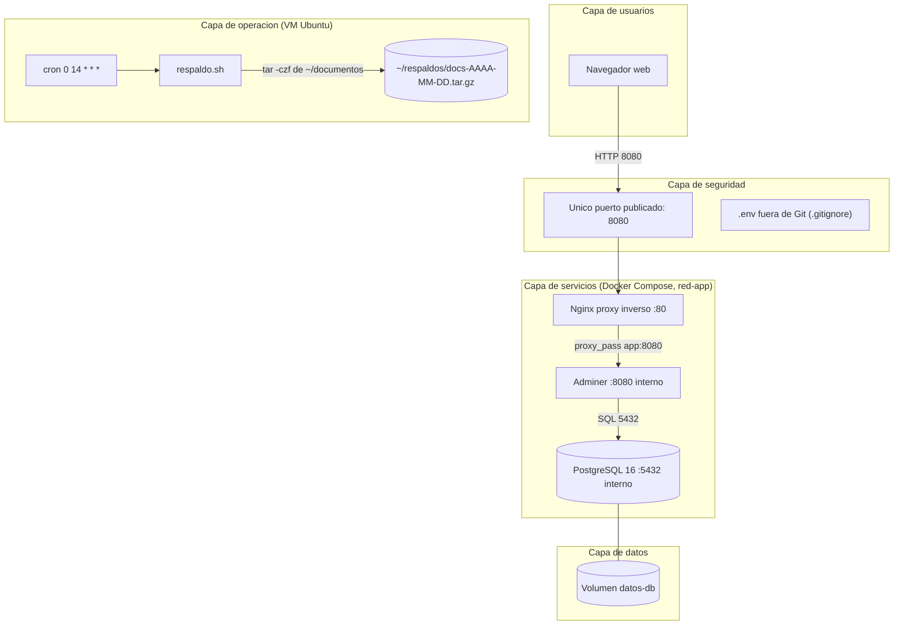
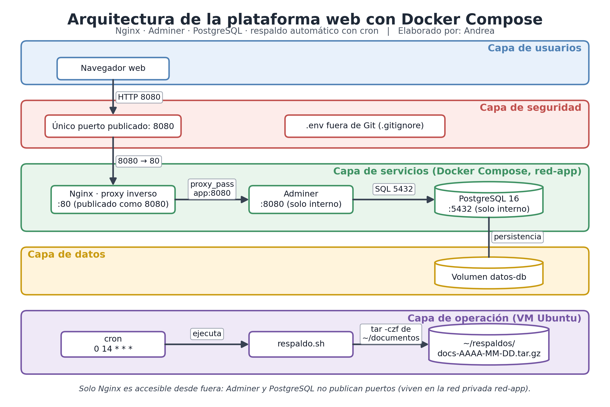

# Arquitectura de la plataforma

## Diagrama por capas

## Decisiones de diseño y alternativas

| Decisión | Alternativa descartada | Justificación |
|----------|------------------------|---------------|
| Nginx como proxy inverso | Exponer Adminer directamente | Un solo punto de entrada; permite agregar HTTPS y límites después |
| Adminer y PostgreSQL sin puertos publicados | Publicar el 5432 | Reduce la superficie de ataque: solo se accede por Nginx |
| Docker Compose | Instalar cada servicio a mano en la VM | Despliegue reproducible con un solo archivo |
| Volumen nombrado `datos-db` | Datos dentro del contenedor | Los datos sobreviven a reinicios y recreaciones |
| Respaldo con cron y script Bash | Respaldo manual | Se ejecuta de forma automática y deja copias fechadas |

